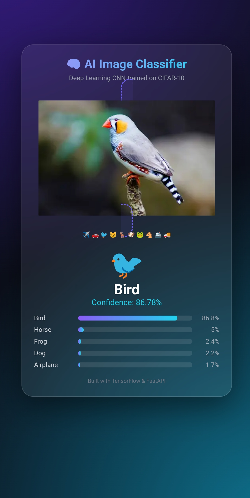

# 🧠 CIFAR-10 Image Classifier

A deep learning CNN that classifies 32x32 color images into 10 classes,
served with FastAPI and a modern dark glass web UI.

## Features
- CNN with BatchNormalization and Dropout
- Data augmentation (flip, shift, rotation, zoom)
- EarlyStopping, ModelCheckpoint, ReduceLROnPlateau
- FastAPI backend with `/predict` endpoint
- Top-5 confidence bars in the web UI

## Results
- Test accuracy: **76.01%**
- Best classes: automobile, truck, ship, horse, frog
- Weak classes: cat, dog, bird (similar looks at 32x32 pixels)

## Classes
airplane, automobile, bird, cat, deer, dog, frog, horse, ship, truck

## Run locally
pip install -r requirements.txt
uvicorn app:app --reload

Then open http://127.0.0.1:8000

## Tech stack
Python, TensorFlow/Keras, FastAPI, HTML/CSS/JS

## Author
Rafaqat, Karak, Pakistan
